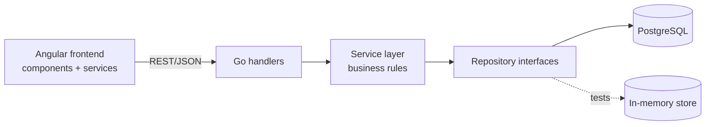
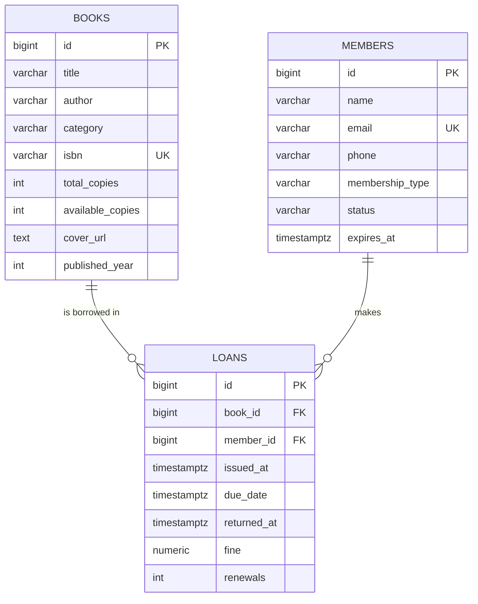

# Bibliotheca – Software Development Life Cycle (SDLC)

**Project:** Library Management System · **Model followed:** Iterative / Agile-style waterfall (plan → analyse → design → build → test → deploy → maintain)
**Stack:** Angular 19 · Go 1.22 · PostgreSQL

---

## 1. Planning
**Goal:** deliver a complete full-stack library system that manages books, members and loans, with persistent storage, a clean API and a user-friendly UI.

| Item | Decision |
|---|---|
| Scope | Dashboard, books, members, issue/return, details & history, persistence |
| Stakeholders | Librarian (primary user), reviewers/mentors |
| Technology | Angular + TypeScript + SCSS; Go REST API; PostgreSQL |
| Deliverables | Source on GitHub, README, screenshots, presentation, submission email |
| Risks | Concurrent issuing of the last copy; invalid data; environment setup differences |
| Mitigations | Mutex + DB row locks; layered validation; Docker/README setup guide; in-memory store for fast unit tests |

**Work breakdown / milestones**
1. Requirements & design  →  2. Database + backend API  →  3. Unit/API tests  →  4. Frontend  →  5. Integration & polish  →  6. Documentation & submission

## 2. Requirements analysis
### 2.1 Functional requirements
| ID | Requirement | Priority |
|---|---|---|
| FR-1 | Dashboard shows total books, total members, issued books, overdue books | Must |
| FR-2 | Add / edit / delete / view books with title, author, category, ISBN, availability | Must |
| FR-3 | Search, filter and sort books | Must |
| FR-4 | Add / edit / delete / view members with name, contact, membership info | Must |
| FR-5 | Issue available books; record issue & due dates | Must |
| FR-6 | Process returns; returned books become available | Must |
| FR-7 | Identify overdue loans | Must |
| FR-8 | Book and member detail pages with borrowing history | Must |
| FR-9 | Persist all data in a relational database | Must |
| FR-10 | Prevent duplicates, validate input, block unavailable issues | Must |
| FR-11 | Renewals, late fees, borrowing limits, cover images, landing page | Should (extras) |

### 2.2 Non-functional requirements
Responsive UI · meaningful error messages · data consistency under concurrency · maintainable layered code · automated tests · simple setup.

### 2.3 User stories
- *As a librarian, I want to see library totals at a glance, so that I know what needs attention.*
- *As a librarian, I want to search and filter books, so that I can find a title quickly.*
- *As a librarian, I want to issue a book to a member and see the due date, so that loans are tracked.*
- *As a librarian, I want unavailable books to be blocked from issue, so that stock stays accurate.*
- *As a librarian, I want to see overdue loans and fines, so that I can follow up.*
- *As a librarian, I want a member's and a book's borrowing history, so that I can audit activity.*

## 3. Design
### 3.1 Architecture

Layered design: **handler** (HTTP) → **service** (rules, validation, concurrency) → **repository** (SQL). Interfaces at each boundary allow the in-memory store to be swapped in for tests.

### 3.2 Database design

Integrity: unique ISBN, unique case-insensitive email, `CHECK (available_copies BETWEEN 0 AND total_copies)`, one open loan per (book, member) enforced by a partial unique index.

### 3.3 API design
RESTful resources (`/books`, `/members`, `/loans`, `/dashboard`) with a consistent envelope and error codes (see README). Status codes: 201, 204, 400, 404, 409, 422, 500.

### 3.4 UI design
Antique library theme: dark walnut panels, brass/gold accents, parchment pages, leather book spines. Flow: **Landing → Dashboard / Books / Members / Loans → Detail pages**. Reusable components: modal, confirm dialog, toast, book cover, status badge, pagination, empty state, stat card, page header.

## 4. Implementation
| Layer | Highlights |
|---|---|
| Backend | Go modules; structs/methods/pointers/interfaces; `sync.Mutex` for lending; goroutines + `WaitGroup` for dashboard; transactions with `FOR UPDATE`; typed errors; middleware (logger, recover, CORS); embedded migrations; seed data |
| Frontend | Standalone components; injectable services; signals; `@if/@for/@switch`; reactive forms; HTTP interceptor; lazy routes; custom pipe; SCSS variables/mixins/BEM |
| Practices | Small commits, separation of concerns, no business logic duplicated in components, meaningful names |

## 5. Testing
### 5.1 Strategy
| Level | Tool | Scope |
|---|---|---|
| Unit | `go test` | Services: validation, rules, availability, fines, renewals, dashboard |
| API | `httptest` | Handlers: CRUD, status codes, search/filter/sort, issue/return flow |
| Concurrency | `go test -race` | 40 goroutines compete for one copy – exactly one succeeds |
| Integration | Manual against PostgreSQL | Issue / return / renew / delete / duplicate rules |
| UI | Manual | Test cases below |

Result: **21 automated tests, 0 failures, race detector clean.**

### 5.2 Manual UI test cases
| # | Scenario | Expected |
|---|---|---|
| T1 | Open dashboard | Four totals shown and match data |
| T2 | Add book with empty title | Field errors shown, nothing saved |
| T3 | Add book with an existing ISBN | "A book with this ISBN already exists" |
| T4 | Search "habit", filter category, sort Z–A | List updates accordingly |
| T5 | Issue a book to a member | Success toast; book copies −1; dashboard "issued" +1 |
| T6 | Issue a book with 0 copies | Blocked with a clear message |
| T7 | Return a loan | Book available again; dashboard updates |
| T8 | View Overdue tab | Late loans highlighted with days late and fine |
| T9 | Delete a book that is issued | Refused with explanation |
| T10 | Refresh the browser | All data still present (database) |
| T11 | Open book / member detail | Details and borrowing history shown |
| T12 | Stop the API | Friendly "cannot reach server" message |

## 6. Deployment
- **Local:** PostgreSQL + `go run` + `npm start` (see README).
- **Containers:** `docker compose up` runs PostgreSQL and the API; Angular production build (`npm run build`) can be served by any static host or Nginx.
- **Configuration** through environment variables; schema applied automatically by embedded migrations.

## 7. Maintenance & future enhancements
Authentication & roles · email/SMS overdue reminders · barcode scanning · reservations/waiting lists · reports & CSV export · CI pipeline (GitHub Actions) running `go test` and `ng build` · Angular unit/e2e tests.
